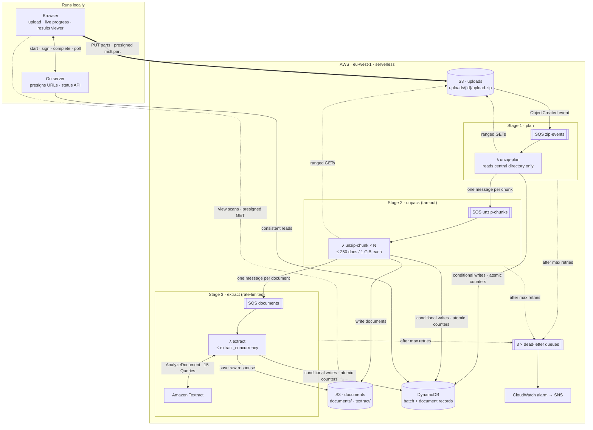
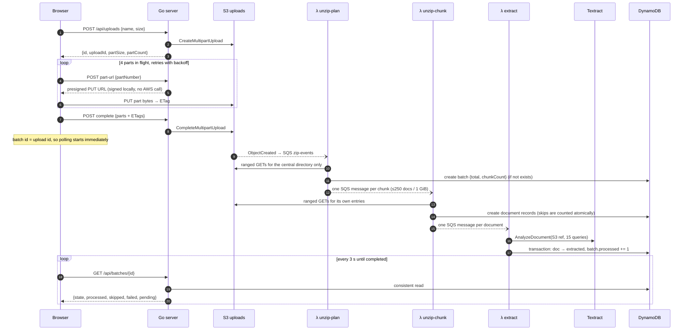

# Bulk Document Onboarding on AWS

A serverless pipeline that turns one uploaded zip of scanned application forms (possibly several gigabytes, thousands of documents) into structured, reviewable data. The browser uploads straight to S3. An event-driven pipeline of SQS queues and Go Lambdas then unpacks the archive, sends every document through Amazon Textract, and records each result exactly once in DynamoDB, while the page shows live progress.

**Stack:** Go · AWS (S3, SQS, Lambda, Textract, DynamoDB, IAM, CloudWatch, SNS) · Terraform · plain HTML/CSS/JS

| | |
|---|---|
| Upload path | Browser → S3 with presigned multipart uploads. The server never touches file bytes. |
| Processing | 3 Lambda stages joined by 3 SQS queues, each with its own dead-letter queue |
| Guarantee | At-least-once delivery in, exactly-once results out (proven with concurrent tests against real DynamoDB) |
| Extraction | 15 named fields per form with Textract Queries, each with a confidence score |
| Measured | 5 handwritten forms extracted 14 s after upload. Go cold starts under 100 ms. |
| Infrastructure | All of it in Terraform, with least-privilege IAM per function |

---

## Contents

1. [The problem](#the-problem)
2. [How I think about it](#how-i-think-about-it)
3. [Architecture](#architecture)
4. [End-to-end flow](#end-to-end-flow)
5. [Design decisions and trade-offs](#design-decisions-and-trade-offs)
6. [Data model](#data-model)
7. [Failure handling](#failure-handling)
8. [Security](#security)
9. [Observability and operations](#observability-and-operations)
10. [Testing strategy](#testing-strategy)
11. [Measured results](#measured-results)
12. [Limitations and next steps](#limitations-and-next-steps)
13. [Repository layout](#repository-layout)
14. [How to run](#how-to-run)

---

## The problem

An investment company receives application forms in bulk: a branch scans a day's paper forms (CIC's *Investments Application Form – Individual*, filled in by hand) and sends them as one zip. Someone then retypes each form into the system.

The requirements I designed for:

- **Large inputs.** One zip can be several GB and hold thousands of scans, so nothing can assume it fits in memory, on a disk, or in a single function's run time.
- **Unreliable everything.** Browser connections drop, Lambdas time out, Textract throttles, and SQS delivers messages more than once. None of these may lose a document or count it twice.
- **Bounded cost and load.** Textract has a per-account requests-per-second quota and charges per page, so the pipeline must control its own pace.
- **Visible progress.** The person uploading needs to see "1,240 of 3,000 processed", plus what was skipped or failed and why.
- **Review-ready output.** Every extracted value carries Textract's confidence, so a later review step can focus on the doubtful ones.

## How I think about it

These principles shaped every part of the design:

1. **Coordinate, don't carry.** The Go server never handles file bytes. It signs short-lived URLs, and the browser and S3 move the data. That keeps the server small and cheap, and its memory use doesn't grow with file size.

2. **Every stage boundary is a queue.** Each step reads from an SQS queue and writes to the next one. A queue absorbs bursts, retries failures, and parks poison messages in a dead-letter queue, so no stage can overwhelm or block another.

3. **At-least-once in, exactly-once out.** I assume every message can arrive twice and any process can die halfway through. Correctness comes from idempotent handlers and conditional writes, not from hoping for a clean run.

4. **Let the data format decide how work is split.** A zip lists every entry's byte offset in a table of contents at the *end* of the file. Reading only that table lets one big job become many small, independent ones without downloading the archive.

5. **Derive state, don't store it.** A batch's state (unpacking, processing, completed) is computed from its counters when it's read. Something that's never stored can't go stale or race.

6. **Concurrency is the rate limiter.** The extract stage processes at most *N* documents at a time, and *N* is a Terraform variable. That one number keeps Textract under its quota and costs predictable.

7. **Interfaces at every AWS edge.** S3, SQS, DynamoDB and Textract each sit behind a small Go interface with an in-memory fake. The whole pipeline runs and is tested on a laptop with no AWS account, and one shared contract test suite keeps each fake honest against the real service.

## Architecture



The Go server and the page run on localhost by design. The processing pipeline is fully serverless in AWS, so there's nothing to keep running between uploads, and an idle deployment costs close to nothing.

## End-to-end flow



### Stage by stage

**1. Upload (browser → S3).** The server opens an S3 multipart upload and picks the part size, 10 MiB by default. The browser slices the file with `File.slice()`, which reads nothing into memory, and PUTs four parts at a time to presigned URLs, collecting each part's ETag. Failed parts are retried with exponential backoff and jitter, a stalled PUT is retried after 60 s, and cancelling aborts the upload so S3 discards the stored parts. The object lands at `uploads/{uuid}/upload.zip`, with the original filename kept in S3 metadata.

**2. Plan (unzip-plan Lambda).** The S3 event names the zip. The planner reads only the zip's **central directory**, a few ranged GETs at the end of the object however large it is. It creates the batch with its total already known, then splits the entries into chunks of at most 250 documents or 1 GiB of compressed data. Entries that will be skipped (for example, over Textract's 10 MB limit) cost the chunk nothing, because they're never read.

**3. Unpack (unzip-chunk Lambdas, in parallel).** Each chunk Lambda reads its own byte ranges through an `io.ReaderAt` built on S3 ranged GETs with an 8 MiB block cache. For each entry it decides one of three outcomes:
- **document:** the extension is PDF, PNG, JPEG or TIFF *and* the first bytes match that format
- **skipped, with a reason:** macOS metadata, a nested zip, an encrypted entry, too large, a mismatched type
- **failed:** a CRC checksum mismatch

Each document is written to `documents/{batch}/{seq}-{name}`, recorded in DynamoDB, and queued, always in that order, so a record never points to a file that doesn't exist and a message never points to a record that doesn't exist.

**4. Extract (extract Lambda, rate-limited).** The Lambda calls Textract `AnalyzeDocument` with the **Queries** feature, one question per field. It passes the document as an S3 reference, so Textract reads it inside AWS and the Lambda never downloads it. The raw response (about 230 KB) goes to S3. The 15 mapped fields, and the batch's `processed` counter, are written in one DynamoDB transaction.

**5. Track (browser ↔ server ↔ DynamoDB).** The page polls `GET /api/batches/{id}` every 3 s. It pauses while the tab is hidden, backs off on errors, and stops once the batch completes. The results page lists every document. Clicking one opens a viewer with the scan, loaded through a short-lived presigned GET URL, beside the extracted fields, with fields under 80 % confidence highlighted.

## Design decisions and trade-offs

### Presigned multipart upload instead of uploading through the server
A multi-GB file streamed through an API server costs bandwidth, memory and time, and ties up the server for the whole upload. With presigned URLs the server signs one specific request (method, key, part number, upload ID, expiry) with its credentials, and the browser sends exactly that request to S3. **Trade-off:** S3 needs a CORS rule for the page's origin, and the bucket must expose the `ETag` header or the browser can't read it to complete the upload.

### Serverless with a fan-out unzip instead of a long-running worker
Lambda's hard limit is 15 minutes, and a 50 GB zip can't be unpacked in that time. My options were:

| Option | Why I didn't pick it |
|---|---|
| A long-running process on ECS/EC2 | No time limit, but it costs money while idle, needs scaling rules, and would pull the whole zip over the network unless it ran inside AWS |
| Step Functions Distributed Map | A strong alternative, but it charges per state transition and adds a second orchestration model next to SQS |
| **SQS fan-out across Lambdas** ✔ | Reuses the queue + DLQ pattern of the other stages. Each chunk gets retries and a DLQ for free. Each chunk's maximum work is bounded by design, so it can't approach the time limit. |

The insight that makes it work is the zip format itself: the central directory lists every entry's offset, so any entry can be read on its own.

### One queue + DLQ per stage
Each queue's visibility timeout is **6× its Lambda's timeout**, AWS's guidance for Lambda consumers. `maxReceiveCount` is 3 for the unzip stages and 5 for extraction. DLQs keep messages for **14 days**, longer than the source queues' 4, because a message moved to a DLQ keeps its original enqueue timestamp and could otherwise expire on arrival. A **redrive allow policy** stops any other queue from using a stage's DLQ.

### Exactly-once results on at-least-once delivery
SQS may deliver the same message to two Lambdas at once. The extract worker defends in three layers, cheapest first:

1. **Already done?** A consistent read finds the document `extracted` and acknowledges the message. A duplicate costs one read, not a Textract call.
2. **Already paid for?** The raw Textract response is saved to S3 *before* the record is updated. A retry that finds it re-parses it instead of calling Textract again.
3. **Conditional transaction.** `CompleteDocument` updates the document *only if its status is still what layer 1 saw*, and increments `batch.processed` in the same `TransactWriteItems` call. If two workers race, one wins and the other gets `ErrConflict`, which counts as success.

A contract test sends **10 concurrent completions** of the same document at real DynamoDB: exactly one succeeds and `processed == 1`. The store also retries `TransactionConflict` cancellations, which happen when many workers increment the same batch item at the same moment.

### Retries with backoff on SQS, which has none built in
SQS has no "retry this message in 2 minutes". The Lambda adapter calls `ChangeMessageVisibility` on the failed message (30 s × 2ⁿ with jitter, capped at 15 min) and reports it in `batchItemFailures`. With `ReportBatchItemFailures` enabled on the event source mapping, Lambda then deletes every other message in the batch and redelivers only the failed one, after the backoff delay. On its final attempt the worker marks the document `failed` first, so the batch can still complete, and the message moves to the DLQ for inspection and redrive.

### Concurrency as the Textract rate limiter
The extract event source mapping has `batch_size = 1` and `maximum_concurrency = extract_concurrency` (default 5). With one document per invocation, "concurrent invocations" means exactly "documents in flight", so this one variable caps Textract load. It shows up directly in the logs as exactly 5 cold starts.

### DynamoDB single-table design, with the store behind an interface
One partition holds a batch and all its documents (`pk = BATCH#<id>`, `sk = BATCH | CHUNK#n | DOC#00000017`). Listing a batch's documents in order is then a single `Query`, and pagination is just "start after `DOC#<seq>`", so the API keeps no cursor state. The table is **on-demand** because the load is bursty: thousands of writes per upload, then nothing. The `Store` interface has no DynamoDB types in it, so a SQLite implementation could replace it without touching the pipeline.

### Textract Queries instead of FORMS
FORMS returns whatever key-value pairs appear on the page, which I would then have to fuzzy-match to my fields. **Queries** asks one question per field ("What is the date of birth?") and returns an answer tagged with my alias. It's a direct match for a fixed schema, and it's priced below FORMS.

Lesson learned from real responses: my first wording for the account number, *"…in the customer's bank details"*, returned **CIC's own printed account number on all 5 forms**. Anchoring the question to the label beside the answer, *"What is the Account No. next to the Account Name?"*, fixed all 5. That comparison is recorded in `internal/extract/fields.go`, and the real responses are kept as test fixtures.

### Keeping the raw response
Each raw response (about 230 KB) goes to S3 rather than DynamoDB, whose items are capped at 400 KB. With the raw responses kept, the field mapping can be changed and re-run over old documents without paying for extraction again.

### Polling instead of websockets
Progress changes every few seconds at most. A `GET` every 3 s (sent with `Cache-Control: no-store`) needs no connection state, no API Gateway websocket setup, and nothing extra in AWS. The page pauses polling while the tab is hidden.

## Data model

**DynamoDB, `textract-onboarding-pipeline`** (on-demand, point-in-time recovery on):

| pk | sk | Attributes |
|---|---|---|
| `BATCH#<id>` | `BATCH` | `sourceKey`, `originalFilename`, `total`, `chunkCount`, `chunksDone`, `processed`, `failed`, `skipped`, `error`, `createdAt`, `updatedAt` |
| `BATCH#<id>` | `CHUNK#0003` | marker, so a retried chunk is counted once |
| `BATCH#<id>` | `DOC#00000017` | `seq`, `filename`, `key`, `contentType`, `size`, `status` (pending / extracted / failed / skipped), `reason`, `fields` (`{name: {value, confidence}}`), `rawKey`, `extractedAt` |

The batch **state** isn't stored. It's derived when the batch is read: `failed` if the zip couldn't be opened, `unpacking` while `chunksDone < chunkCount`, `processing` while documents are pending, then `completed`.

**S3 layout:**

```
uploads bucket     uploads/{batchId}/upload.zip            original zip (x-amz-meta-original-filename)
documents bucket   documents/{batchId}/{seq:06d}-{name}    each extracted document
                   textract/{batchId}/{seq:06d}.json       raw AnalyzeDocument response
```

**Queue messages** carry identifiers only (around 150 bytes), and the datastore is the source of truth:

```json
{ "v": 1, "batchId": "…", "seq": 17, "bucket": "…-documents-…", "key": "documents/…/000017-form.jpeg" }
```

## Failure handling

| What goes wrong | What happens |
|---|---|
| A browser part upload fails or stalls | Retried up to 5× with jittered backoff and a freshly signed URL. A stall after 60 s counts as a failure. |
| The user cancels or closes the tab | In-flight parts are stopped, then the multipart upload is aborted (`sendBeacon` on tab close). A 7-day S3 lifecycle rule is the backstop. |
| The upload isn't a readable zip | The batch is recorded as `failed` with the reason. No retry, because retrying can't fix it. |
| A zip entry is junk (wrong type, `__MACOSX`, nested zip, encrypted, > 10 MB, empty) | Recorded as `skipped` with a human-readable reason and counted. Nothing is silently dropped. |
| A zip entry is corrupt (CRC mismatch) | Recorded as `failed` and never written to the documents bucket |
| A Lambda dies halfway through | The message reappears after its visibility timeout. Every stage is idempotent, so redoing the work is safe. |
| SQS delivers a message twice | Already-extracted documents are skipped. Counters move only inside conditional transactions. |
| Textract throttles or has a 5xx error | The SDK retries quickly. After that, the SQS backoff takes over (30 s → 15 min). |
| A document is unreadable to Textract (unsupported, corrupt, multi-page PDF) | Marked `failed` at once with the reason, without retrying |
| An IAM misconfiguration (`AccessDenied`) | Treated as *retryable* on purpose: messages land in the DLQ to be redriven after the policy is fixed, rather than every document being marked failed |
| Retries run out | The document is marked `failed` (so the batch completes), the message moves to the DLQ, and a CloudWatch alarm goes off |
| A DLQ message is redriven and now succeeds | The document moves from `failed` to `processed` in one atomic step |

## Security

- **No long-lived keys anywhere.** Locally the SDK uses an AWS profile. Lambda functions get temporary credentials from their execution role, through the same default credential chain.
- **Least-privilege IAM, one role per function.** Each role can touch only its own queue, its own S3 prefixes and the table actions it uses. For example:
  - `unzip-plan` can `PutItem` but not update.
  - `extract` can `UpdateItem` but not create.
  - `textract:AnalyzeDocument` uses `*` only because Textract doesn't support resource-level permissions.
- **Confused-deputy protection.** The SQS queue policy lets S3 send messages only from *this* bucket in *this* account (`aws:SourceArn` and `aws:SourceAccount`). The Lambda trust policy is pinned to the account in the same way.
- **Private buckets.** Public access is blocked on both buckets, objects are encrypted at rest, and the documents bucket is versioned. The browser only ever gets **presigned URLs**: PUTs valid for 15 minutes for uploads, GETs valid for 5 minutes for viewing, signed fresh for each request.
- **Input validation.** Only `.zip` uploads are accepted, with an upper size limit. Upload IDs are UUIDs, and the server builds every S3 key itself, so a client can't aim at another object. Zip entry names are sanitised and entry sizes are checked against their headers (zip-bomb defence). Every value rendered on the page is inserted as text, never as HTML.

One subtlety the IAM work showed: without `s3:ListBucket`, S3 answers a request for a *missing* object with **403**, not 404. The extract worker checks whether a raw response already exists, so its role needs `ListBucket` on the documents bucket to get a real 404.

## Observability and operations

- **Structured logs.** Every function writes JSON lines (`batch`, `seq`, `attempt`, `err`) that CloudWatch Logs Insights can query. Log groups are created by Terraform with 14-day retention, instead of Lambda's default of keeping logs forever.
- **Alarms.** Each DLQ has a CloudWatch alarm that fires on its first message and notifies an SNS topic, optionally by email.
- **Redrive.** Failed work waits in a DLQ for 14 days. Fix the cause, then move the messages back to the source queue. That's safe because every stage is idempotent.
- **Cost tags.** Every resource is tagged `Project` / `ManagedBy`, so Cost Explorer can show this project's spend.

## Testing strategy

| Layer | What it proves | AWS? |
|---|---|---|
| Unit tests with fakes | Every handler, filter rule, retry path and edge case: duplicate delivery, races, corrupt entries, the last attempt going to the DLQ, redrive | No |
| **Store contract suite** | One test suite that every `Store` implementation must pass, including *10 concurrent workers → counted once*. The in-memory fake runs it on every test run, and DynamoDB runs it against a temporary table. | Opt-in |
| Real-response fixtures | The Textract mapping is tested against **5 real responses** from handwritten sample forms, all 15 fields each | No |
| Real-AWS adapter tests | Ranged S3 reads, partial SQS batch failures, Textract error classification, each with self-cleaning scratch resources | Opt-in |
| `cmd/dev` | The whole pipeline in one process with fakes, with simulated latency, throttling and chunking | No |
| Browser end-to-end | Headless Chrome uploads a real zip against the deployed stack and checks progress, results and the document viewer | Yes |

## Measured results

From real runs against the deployed stack, with a 4.2 MB zip of 5 handwritten forms and 2 decoy files:

| Measure | Result |
|---|---|
| Browser upload | 3.9 s |
| Upload → batch visible | about 4 s (S3 event → SQS → planner) |
| Upload → all 5 forms extracted | 14 s |
| Decoys | 2/2 skipped with reasons (`.txt`; a JPEG renamed to `.pdf`) |
| Fields extracted | 15/15 on every form. Account number correct 5/5 after tuning the query wording (it was 0/5 before). |
| Lambda cold start (Go, arm64) | 76–97 ms |
| Extract time per document | 4–7 s, almost all of it Textract |
| Lambda memory used | about 40–50 MB |
| Ranged reads | A 3.6 MB zip read from S3 in 1 GET (8 MiB blocks), or 16 GETs at 256 KiB |
| Cost | Textract is about $0.015 per page. Everything else is pay-per-use and close to $0 when idle. |

## How to run

### 1. Build the Lambdas and deploy the infrastructure

```bash
make build                                     # cross-compiles the 3 Lambda binaries into build/
cd infra
cp terraform.tfvars.example terraform.tfvars   # set profile, bucket_suffix, allowed_origin
terraform init
terraform apply
terraform output                               # bucket and table names for .env
```

Terraform uploads the binaries from `build/`, so run `make build` before every `terraform apply` that includes Lambda changes. `make deploy` does both. Your AWS user needs S3, SQS, DynamoDB, Lambda, IAM, CloudWatch and Textract permissions.

`allowed_origin` must be the origin the page is served from, which is `http://localhost:5173` by default. If it doesn't match, the browser blocks its direct PUTs to S3.

Terraform variables (`terraform.tfvars`): `profile`, `region`, `bucket_suffix`, `allowed_origin`, `extract_concurrency` (default 5; check your Textract `AnalyzeDocument` quota before raising it) and `alarm_email` (optional).

| Terraform file | Creates |
|---|---|
| `uploads.tf`, `documents.tf` | The two S3 buckets: encryption, public access blocked, CORS for direct browser uploads, lifecycle rule for abandoned multipart uploads |
| `dynamodb.tf` | The on-demand single table |
| `sqs.tf` | 3 queues + 3 DLQs, with visibility timeouts derived from the Lambda timeouts |
| `notifications.tf` | The S3 → SQS event notification and its scoped queue policy |
| `iam.tf` | One least-privilege execution role per Lambda |
| `lambda.tf` | 3 Go functions (`provided.al2023`, arm64), log groups, SQS event source mappings |
| `alarms.tf` | DLQ alarms and an SNS topic |

### 2. Set the environment

```bash
cp .env.example .env    # then edit
```

The server loads `.env` on startup. Variables already set in your shell take precedence over the file, so `ADDR=:8080 go run ./cmd/server` overrides a single value.

| Variable | Default | Purpose |
|---|---|---|
| `UPLOADS_BUCKET` | (required) | Bucket the zips are uploaded to |
| `PIPELINE_TABLE` | (empty) | DynamoDB table for batch status (`terraform output pipeline_table`). Empty disables the status endpoints. |
| `DOCUMENTS_BUCKET` | (empty) | Documents bucket (`terraform output documents_bucket`). The results page uses it to show each scan. Empty disables previews. |
| `AWS_PROFILE` | SDK default | AWS profile. The AWS SDK reads it directly. |
| `AWS_REGION` | `eu-west-1` | Region of the bucket |
| `PART_SIZE_MB` | `10` | Size of each part. S3's minimum is 5. Max upload ≈ part size × 10,000. |
| `MAX_UPLOAD_GB` | `50` | Uploads larger than this are rejected at start |
| `PRESIGN_TTL` | `15m` | How long a presigned part URL stays valid |
| `ADDR` | `:5173` | Address the server listens on |
| `ALLOWED_ORIGIN` | (empty) | Enables API CORS for a frontend served from another origin. Leave empty when this server serves the page. |

### 3. Run

```bash
go run ./cmd/server
```

On startup the server checks that it can reach the bucket and exits with an error if it can't. Then open http://localhost:5173 and drop a zip. When the upload finishes, the page polls the batch's progress, and **View results** opens `batch.html?id=<batch>`. Click any document to see its scan beside the extracted fields. The server serves the page from `web/`, so start it from the repo root, and restart it after pulling code changes.

### 4. Smoke test with curl

```bash
./scripts/smoke-upload.sh            # uploads 1 MiB of random bytes as a single part
./scripts/smoke-upload.sh my.zip     # or a real file (under PART_SIZE_MB, as it sends one part)
```

### 5. Run the whole pipeline locally, without AWS

`cmd/dev` runs every stage in one process, with in-memory fakes for S3, SQS, DynamoDB and Textract. All the stages have to share that one process because the fakes live in memory.

```bash
zip -r forms.zip testdata/forms
go run ./cmd/dev -zip forms.zip                                    # http://localhost:5180
go run ./cmd/dev -zip forms.zip -chunk-entries 2 -fail-rate 0.3    # watch chunking and retries
go run ./cmd/dev                                                   # or a demo batch that advances by itself
```

It prints the batch summary and each skipped entry with its reason, extracts documents in the background, and serves the status API and results page. For the sample forms, the fake Textract replays the real responses saved in `testdata/textract/`, matched by file content. For any other image it makes up plausible values.

| Flag | Default | What it simulates |
|---|---|---|
| `-chunk-entries` | 250 | Max documents per unzip chunk |
| `-workers` | 4 | Documents extracted at once (the extract Lambda's `maximum_concurrency`) |
| `-latency` | 1.5s | Textract time per document |
| `-fail-rate` | 0 | Fraction of Textract calls that get throttled |
| `-backoff-scale` | 0.02 | Shrinks retry delays locally (30s becomes 0.6s) |
| `-docs`, `-every` | 40, 1s | Size and pace of the demo batch (no `-zip`) |

### 6. Tests

```bash
go test ./...          # everything, against in-memory fakes, no AWS needed
```

Tests against real AWS are opt-in:

```bash
AWS_TEST=1 AWS_PROFILE=textract-onboarding \
DOCUMENTS_BUCKET=$(terraform -chdir=infra output -raw documents_bucket) \
go test -count=1 -v ./internal/batch/dynamostore ./internal/blob/s3blob ./internal/queue/sqsqueue ./internal/extract/textractclient
```

| Package | What the test does | Cost |
|---|---|---|
| `dynamostore` | Runs the Store contract suite on a temporary table, then deletes it | < $0.01 |
| `s3blob` | Reads a zip of the sample forms from S3 through ranged GETs | < $0.01 |
| `sqsqueue` | Sends 23 messages through a temporary queue | < $0.01 |
| `textractclient` | One real `AnalyzeDocument` call on sample form 1 | ~ $0.015 |

Test objects go under `test/` in the documents bucket, and every version of them is deleted when the test ends.

### 7. Operating it

```bash
# Follow a function's logs (JSON lines: query them in CloudWatch Logs Insights)
aws logs tail /aws/lambda/textract-onboarding-extract --follow --profile textract-onboarding

# Something in a DLQ? Read it, fix the cause, then send the messages back to the source queue
aws sqs receive-message --queue-url "$(terraform -chdir=infra output -json dlq_urls | jq -r .documents)" --profile textract-onboarding
aws sqs start-message-move-task --source-arn <dlq arn> --profile textract-onboarding   # "redrive"
```

### API reference

| Endpoint | Body | Response |
|---|---|---|
| `POST /api/uploads` | `{filename, size, contentType}` | `201 {id, uploadId, key, partSize, partCount}` |
| `POST /api/uploads/{id}/part-url` | `{uploadId, partNumber}` | `200 {url}` |
| `POST /api/uploads/{id}/complete` | `{uploadId, parts: [{partNumber, etag}]}` | `200 {key}` |
| `POST /api/uploads/{id}/abort` | `{uploadId}` | `204` |
| `GET /api/batches/{id}` | | `{id, state, originalFilename, total, processed, failed, skipped, pending, chunks: {done, total}, error, createdAt, updatedAt}`. `state` is `unpacking`, `processing`, `completed` or `failed`. Returns 404 until the batch exists. |
| `GET /api/batches/{id}/documents?after=0&limit=50` | | `{documents: [{seq, filename, status, reason, key, contentType, size, fields: {name: {value, confidence}}, extractedAt}], next}`. Pass `next` as `after` for the next page; `null` on the last page. |
| `GET /api/batches/{id}/documents/{seq}/file` | | `302` redirect to a presigned S3 GET URL, valid for 5 minutes |

Errors return `{"error": "..."}`.
